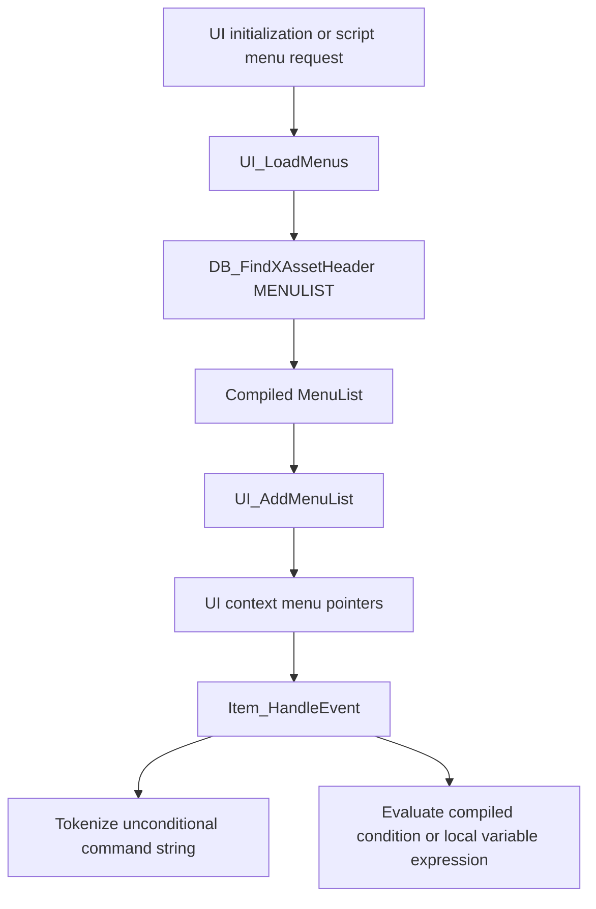

# IW4 x64 menu loading and parsing

The normal menu-loading path in the inspected x64 executable consumes compiled
menu assets. It does not open and compile `.menu` source files. The parsing code
that remains in that path tokenizes command strings inside compiled event
handlers; menu conditions and expressions arrive as structured records.

This distinction limits what the executable can validate about GSCLSP. Its
59-command table exactly matches the editor catalog, but its expression table
contains six additional functions. The source grammar used by IW4x's loose-file
overrides belongs to staging's OpenAssetTools compiler and must be validated
against that compiler separately.

## Target and evidence

Analysis date: 2026-10-09. The target was opened through IDA Pro's headless API.
All database queries were read-only; no patches, renames, type edits or engine
bindings were made.

| Property | Value |
| --- | --- |
| Database | `idb/iw4mp_x64.i64` |
| Input recorded by IDA | `D:\IW64x\english\iw4mp-x64.exe` |
| Architecture | PE, x86-64 |
| Image base | `0x140000000` |
| Input SHA-256 recorded by IDA | `d52613308e66cde38390ec07661478684906384943da62efdaee82e7692fcda4` |
| Staging source revision | `1549dba0f690e3a991a3e156b27e81cb9a55ed61` |

Addresses below are database virtual addresses. The hash identifies IDA's input,
not a new hash of an installed game or of the database file. Names and types in
this reconstructed IDB are navigation aids. Conclusions below use decompiled
control flow, data reads and selected instruction-level checks; existing IDB
comments are not independent validation.

[The extracted evidence](menu-x64-evidence.json) contains all 59 commands with
handler addresses, all 192 operator names, the precedence table, callers of the
menu loader and event dispatcher, the six relevant switch targets, UI script
subcommand spellings, and the source-keyword scan results. This is static
analysis, not an execution test or source-compiler conformance test.

## Loading a menu

`UI_LoadMenus` at `0x14026C830` is exactly this three-instruction wrapper:

```asm
14026C830  mov rdx, rcx
14026C833  mov ecx, 19h
14026C838  jmp DB_FindXAssetHeader
```

`RCX` initially holds the asset name. It becomes the lookup's second argument;
asset type `0x19` is `ASSET_TYPE_MENULIST`. The incoming image-track argument is
not used. There is no source read, lexer or grammar dispatch in this function.

`Load_ScriptMenu` at `0x14026DE20` builds
`ui_mp/scriptmenus/<name>.menu`, calls that wrapper, and passes the resulting
list to `UI_AddMenuList`. The `.menu` suffix here names an asset; it does not
establish that a source file is opened.

Confirmed call sites of `UI_LoadMenus`:

| Caller | Call instruction |
| --- | --- |
| `CG_Init` | `0x1400D2DC8` |
| `Load_ScriptMenu` | `0x14026DE7E` |
| `UI_Init` | `0x1402716CD`, `0x140271700`, `0x140271722` |
| `UI_LoadIngameMenus` | `0x140271C34` |

`UI_LoadIngameMenus` at `0x140271C10` loads the asset `ui_mp/ingame.txt`
once behind its loaded flag. `DB_FindXAssetHeader` at `0x140129220` searches and
marks database entries, waits for database readiness when necessary, and can
create a default entry on a miss. Its inspected body has no `.menu` text-parser
fallback.

`UI_AddMenuList` at `0x14026B6C0` registers the actual pointers from
`MenuList.menus` into the UI context. It checks a 640-menu capacity, touches each
menu's `ASSET_TYPE_MENU` lookup, and optionally closes the registered menu.
It does not replace the list pointer with the result of that per-menu lookup.
The registered menus remain borrowed asset objects.



### Source parser search

No functions matching `Menu_Parse`, `Item_Parse`, `Menu_New`, `PC_ReadToken` or
`PC_LoadSource` were found by the function-name inventory. A separate raw byte
scan searched `.text`, `.rdata` and `.data` for case-insensitive, NUL-terminated
ASCII and UTF-16LE suffixes of:

```text
menudef itemdef functiondef loadmenu onopen onclose execkey dvarstrlist
pc_readtoken pc_loadsource
```

The only hit was `itemdef` inside the descriptive string
`The number of steps for a slider itemdef`, at suffix address `0x1403C93C1`.
It is not a property dispatch table. The scan also avoids relying solely on
IDA's recognized-string inventory.

Together with the traced loading path, this is strong evidence that this build
has no conventional text menu compiler on its normal UI path. It is not a proof
that arbitrary unrecognized or encoded code could never parse a related format.
In particular, the names `MenuParse_ParseLerp` and
`MenuParse_ParseTransitionDetails` describe runtime command-argument parsers,
not `menuDef` or `itemDef` source parsers.

## Compiled representation

The asset loaders deserialize stream records and fix up pointers. They do not
recognize source keywords.

| Routine | Address | Observed representation |
| --- | --- | --- |
| `Load_MenuList` | `0x14011B460` | 24-byte header; name at `+0`, signed count at `+8`, pointer array at `+0x10`; 8 bytes per menu pointer |
| `Load_menuDef_t` | `0x140122E60` | 488-byte menu; nested window, strings, event sets, key handlers, expression statements and item pointers |
| `Load_MenuEventHandlerSet` | `0x14011B200` | 16-byte set; count and pointer array; each handler is 16 bytes with a byte tag at `+8` |
| `Load_Statement` | `0x14011C390` | 48-byte statement; count at `+0`, entries at `+8`; entries are 24 bytes each |

The `Load_MenuList` offsets were checked in instructions at
`0x14011B46B`, `0x14011B4E0`, `0x14011B519` and `0x14011B51C`, since its
pseudocode's inferred pointer arithmetic obscures the count field. Likewise,
`Item_HandleEvent` reads the handler tag with
`movzx r8d, byte ptr [rbx+8]` at `0x140261014`. These observations concern the
inspected fields, not a fresh validation of every menu/item structure member.

`Item_HandleEvent` at `0x140260FB0` dispatches these seven event tags:

| Tag | Payload behavior |
| --- | --- |
| 0 | Tokenize and execute an unconditional script string |
| 1 | Evaluate a compiled condition; recursively execute its handler set when true |
| 2 | Execute an else handler set when the preceding condition failed |
| 3 | Evaluate and assign a local boolean |
| 4 | Evaluate and assign a local integer |
| 5 | Evaluate and assign a local float |
| 6 | Evaluate and assign a local string |

A flag in the event-set loop carries the failed-condition result to `else` and
is cleared when that else executes. Unsupported event tags reach `Com_Error`.
The condition and local-variable branches consume `Statement` pointers, not
source expression text. `if`, `else` and dynamic `setLocalVar*` therefore cannot
be modeled as ordinary flat command strings alone.

## Runtime command tokenization

The unconditional branch of `Item_HandleEvent` parses its stored string with
`Com_ParseOnLine`, performs optional `@` localization, skips a token that is
exactly `;`, and compares the remaining command against `commandList` using
`I_stricmp`. At `0x1402610F3` it advances each table entry by `0x10`; at
`0x1402610F7` it checks the 59-entry bound. The handler receives the UI context,
item pointer and mutable text cursor in `RCX`, `RDX` and `R8` at the indirect call
`0x14026111F`.

`commandList` at `0x1403C7B50` is 59 pairs of 8-byte pointers: command name and
handler. Its ordered names match
[`commands.json`](../packages/core/src/menu/commands.json) exactly. This is now
an x64 validation, independently of the earlier 32-bit inspection.

A failed table search is not a source syntax diagnostic: the loop separately
checks for `uiScript`, then continues parsing. `UI_RunMenuScript` at
`0x140273F10` parses the subcommand and uses its own case-insensitive dispatch,
including `StartServer`, `loadArenas`, `openMenuOnDvar` and `closeMenuOnDvar`.
The JSON records the 21 distinct literal names compared with its subcommand
buffer; this is separate from the 59-entry command table.

Two recognized table entries, `setPlayerDataSplitScreen` and `showGamerCard`,
point to the same empty function at `0x14007CC50`. Recognizing a spelling does
not imply that it performs useful work in this build.

### Lexer behavior

| Routine | Address | Role |
| --- | --- | --- |
| `Com_ParseExt` | `0x14028D1E0` | Shared lexer using the current thread's parse-session state |
| `Com_ParseOnLine` | `0x14028D6B0` | Token pushback handling, then `Com_ParseExt(cursor, 0)` |
| `String_Parse` | `0x14026B580` | Token parsing, optional localization, bounded copy |
| `Float_Parse` | `0x14026CEA0` | Token parsing, optional separate minus token, `atof` conversion |
| `Com_BeginParseSession` | `0x14028CC50` | Initializes a nested parse session |

The relevant `Com_ParseExt` branches establish:

- Whitespace, `//` comments and `/* ... */` comments are skipped. Line counts
  are maintained. Disallowed line breaks encountered by the whitespace loop
  return an empty token without advancing the caller's cursor to the next token.
  The block-comment loop has its own line counting; this is not a universal
  prohibition on newline characters anywhere in an input string.
- Quoted strings decode `\"` and `\\`. Other backslash sequences are retained
  by this runtime lexer. The quote loop does not reject a physical newline as
  the editor's source-string lexer does.
- Tokens use a 1024-byte session buffer. The normal copy loops retain at most
  1023 bytes and append NUL while continuing to scan the input.
- With `spaceDelimited` set, an unquoted token runs to whitespace. A semicolon
  attached to another unquoted token is not automatically split in this mode.
  With that flag clear, number, identifier and punctuation branches are used.
- `Com_BeginParseSession` writes `0x100` across the four flags starting at
  `+0x404`, making `spaceDelimited` true and `ungetToken`, `keepStringQuotes` and
  `csv` false. It separately clears `negativeNumbers`. The event dispatcher
  itself does not begin a fresh parse session, so these flags are contextual;
  the default is not a claim about every possible caller's state.

The token is borrowed current-session storage and can be overwritten by the
next parse. `String_Parse` copies it into the caller's buffer. A leading `@`
requests `SEH_StringEd_GetString`; missing translations can raise a localization
error when both localization-warning dvars are enabled. It tests the updated
source cursor for EOF, not simply whether the token is empty.

`Float_Parse` is conversion, not strict number validation: after an optional
separate `-`, it rejects an empty token and otherwise passes the token to `atof`.
This behavior must not be used to declare a malformed numeric *source property*
valid, because the source compiler parses it before this runtime path exists.

### Representative command parsers

- `Script_SetDvar`, `0x14025FC20`, calls `String_Parse` twice with 1024-byte
  buffers, then `Dvar_SetFromStringByName` with the parsed name and value.
- `Script_SetColor`, `0x14025E3A0`, recognizes `backcolor`, `forecolor` and
  `bordercolor`, then tries up to four `Float_Parse` calls. Successfully parsed
  components are written immediately; an early failure leaves later components
  unchanged. It is not an atomic four-component assignment. Since `Float_Parse`
  does not reject `;` or another nonnumeric token before `atof`, a missing
  component followed by a semicolon is not a reliable early-failure boundary;
  malformed serialized commands can consume subsequent command tokens.
- `Script_SetLocalVarBool`, `0x140260040`, reads name/value strings with
  256-byte buffers and converts the value with `atoi(value) != 0`.
  `Script_SetLocalVarString`, `0x1402601F0`, reads two strings and assigns the
  second. These constant command forms coexist with compiled event tags 3–6.
- `Script_HandleTransition`, `0x1402607A0`, forwards to
  `MenuParse_ParseLerp`, `0x14026C840`. The latter selects a transition and
  calls `MenuParse_ParseTransitionDetails`, `0x14026C9C0`, which loops over
  `from`, `to` and `over` plus float values until all three have been found or
  parsing fails. It does not parse a menu definition.
- `Menus_FindByName`, `0x1402694E0`, scans registered menus with `I_stricmp`
  and returns the first matching borrowed menu. Case-insensitive menu-name
  navigation in GSCLSP is consistent with that runtime lookup.

## Compiled expression evaluation

`EvaluateExpression` at `0x140253430` consumes the statement's entry array:
entry type 0 is an operator; type 1 supplies an operand. An operand of type 3
refers to another statement and is evaluated recursively. The evaluator
operates on explicit operator and operand stacks and calls `RunOp`; it does
not lex expression text or resolve a source `functionDef` name.

`g_expOperatorNames` at `0x14046BCB0` contains 192 names, indices 0–191.
Indices 0–22 describe operators/delimiters, 23–26 are static dvar forms, and
27 onward are named functions. No direct IDA xref to the start of this name
table was reported; the table's presence alone is not evidence of a source
name-to-opcode compiler.

Execution support is independently corroborated by `RunOp` at `0x140254A10`.
Its second switch subtracts 30 and checks an unsigned upper bound of 161 at
`0x1402558BA`–`0x1402558C2`, covering opcodes 30–191. The switch table starts at
`0x14025B1C4`.

The six names missing from GSCLSP's 159-function expression catalog are:

| Opcode | Name | Switch target | Observed operation |
| --- | --- | --- | --- |
| 186 | `dowehavemappack` | `0x1402564CD` | Consumes/converts one argument and calls `Content_DoWeHaveContentPack` at `0x140256551` |
| 187 | `cantogglefullscreen` | `0x14025B01A` | Produces integer 1 without popping arguments |
| 188 | `isbasegamelicensevalid` | `0x14025B030` | Calls the license-validity helper and produces its byte as an integer |
| 189 | `isprofilesyncedwithcloud` | `0x14025B047` | Calls the cloud-sync helper and produces a normalized boolean integer |
| 190 | `getstoremismatchmessagegdk` | `0x14025B061` | Builds a localized account-specific message and returns a string |
| 191 | `getpartyinvitedescription` | `0x14025B0CA` | Builds a localized party-invite description and returns a string |

The remaining 159 catalog function spellings all occur in the x64 table.
However, the vendored OAT IW4 name table also ends before these six functions.
Adding completion labels alone would not make them compilable by staging's
current source parser. Source-compiler and conversion support must be checked
before promising them as usable loose-menu features.

The 23 integer precedence values at `0x14046B450` are:

```text
INT_MAX, 0, 11, 11, 11, 13, 13, 9, 15, 15, 15, 15,
16, 16, 25, 25, 99, 80, 17, 18, 9, 14, 14
```

Lower values bind earlier in the inspected evaluator. Function opcodes use
precedence 5 through a separate path. Notably `&&` and `||` both have 25;
`/`, `%` and `-` have explicit equal-operator reduction rules. Do not substitute
a JavaScript or C expression evaluator and assume equivalent semantics.
GSCLSP currently evaluates no menu expressions. This research does not claim a
complete audit of every `RunOp` branch, cache behavior or malformed bytecode.

## Where loose source is actually compiled

Staging's [`mod/menu.cxx`](../../staging/libiw4x/libiw4x/mod/menu.cxx) intercepts
menu-list asset lookup and substitutes compiled disk-menu objects. Its
[`open-asset-tools.cxx`](../../staging/libiw4x/libiw4x/shim/open-asset-tools/open-asset-tools.cxx)
creates an IW4 menu-list loader with a recording search path.

The source chain in `upstream/open-asset-tools/src` is:

```text
ObjLoading/Game/IW4/Menu/LoaderMenuListIW4.cpp
  -> MenuFileReader(FeatureLevel::IW4)
  -> comment removal, include processing, define processing
  -> SimpleLexer
  -> MenuFileParser and scope sequences
  -> IW4 menu conversion and asset registration
```

`MenuFileReader.cpp` disables emitted newline tokens and enables string escapes
and numeric lexing. `EventHandlerSetScopeSequences.cpp` writes parsed generic
commands as quoted tokens separated by spaces, appending `; ` and accepting an
optional source semicolon. Conditions and dynamic local-variable assignments
become structured event records. This explains why raw source token boundaries
need not equal the runtime string lexer's token boundaries.

Two source details matter when comparing the editor with the executable:

1. `Parser/Parsing/Impl/AbstractLexer.h::ReadStringWithEscapeSequences` rejects
   an unclosed string at the physical line boundary. Its unescape helper in
   `Utils/Utils/StringUtils.cpp` decodes `\r`, `\n`, `\t`, `\f`, `\"`, `\\`,
   and removes the slash from other escapes. The runtime lexer has different
   rules. GSCLSP's physical-newline error matches this source layer.
2. `ObjLoading/Parsing/Menu/Sequence/Generic/GenericColorPropertySequence.cpp`
   accepts one mandatory numeric component and three optional components;
   omitted components become zero. This differs from `Script_SetColor`, whose
   partial writes preserve remaining runtime components. GSCLSP's `r g b a`
   hover is only a full-form example, and its swatches cover four literal
   components, not every accepted color property form.

Includes use the configured search path.
`ObjCommon/SearchPath/SearchPathMultiInputStream.cpp::OpenIncludedFile` ignores
its `sourceFile` argument and calls `m_search_path.Open(filename)`. Staging's
recording search path checks each content root. GSCLSP additionally falls back
to the including file's directory; that editor convenience can resolve a path
that staging would reject.

## Assessment before the compatibility pass

| Area | Result and implication |
| --- | --- |
| UI command vocabulary | All 59 names and their order match the x64 table. `uiScript` is a separate dispatch. |
| Expression vocabulary | 159 names match; six runtime names are absent from both GSCLSP and the inspected OAT table. |
| Source block grammar | Still based on OAT. The executable's asset loader cannot validate every `menuDef`/`itemDef` property or its arity. |
| Conditions and local variables | Compiled tags confirm that these have structure beyond flat commands. GSCLSP recognizes scopes but does not compile expressions/events. |
| Source strings | Newline rejection agrees with OAT, despite differing from runtime tokenization. `menuTokenValue` only strips quotes, so escaped-name navigation does not implement OAT's decoded string values. |
| Includes | Root lookup agrees with staging; the editor's relative-directory fallback is broader than the compiler. |
| Colors | Four-component swatches are a supported subset. Source properties permit fewer components; runtime partial updates have different semantics. |
| Directives | The x64 loading path provides no macro-expansion oracle. GSCLSP neither expands macros nor chooses conditional branches. |
| Diagnostics | Structural editor diagnostics are not proof that OAT can compile the document. Preprocessed files deliberately suppress delimiter diagnostics. |

The subsequent GSCLSP compatibility pass implements source escape decoding for
names and `loadMenu` strings, content-root-only include lookup, and swatches for
one to four literal color components with zero defaults. Original source ranges
are retained for navigation and edits. Swatches skip macro/expression values;
color presentations expand to all four components. Catalog hovers document these
defaults, runtime color-command caveats, and the two x64 no-op commands.

Regression tests cover decoded-name navigation over LSP, nested root-only includes,
partial colors, and exclusion of unsupported runtime expression functions. The
six extra runtime functions remain excluded from the source vocabulary until OAT
supports them. These tests exercise editor behavior against the inspected source
rules; they do not execute OAT or the game, expand macros, or establish full source
compiler conformance.

## Reproducing the table checks

With this exact x64 database open, these read-only IDAPython expressions recover
the command and operator spellings directly from pointer tables:

```python
import ida_bytes

def text_at(pointer):
    return ida_bytes.get_strlit_contents(pointer, -1, 0).decode("ascii")

commands = [
    text_at(ida_bytes.get_qword(0x1403C7B50 + i * 16))
    for i in range(59)
]
operators = [
    text_at(ida_bytes.get_qword(0x14046BCB0 + i * 8))
    for i in range(192)
]
tail_targets = [
    0x140000000 + ida_bytes.get_dword(0x14025B1C4 + (i - 30) * 4)
    for i in range(186, 192)
]
```

Compare `commands` with `packages/core/src/menu/commands.json`; compare
`operators[27:]` with entries whose `scope` is `expression` in `catalog.json`.
The extracted JSON preserves the result used here. No game process was run,
no `.menu` was compiled by the x64 executable, and no new production engine
layout or ABI declaration follows from this report.
